# Round 2 workflow (as implemented in `src/orchestrator.py`)

```mermaid
flowchart TD
    subgraph BOOT["Boot — NOVA"]
        A["Load model.joblib + threshold.txt (0.54)"] --> B["Validate config/crew.json (12 profiles)"]
        B --> C["Open memory: faiss, else tfidf"]
        C --> D["Load state/seen.json (idempotency)"]
    end
    D --> E["Batch classify input CSV → verdict, proba"]
    E --> F{"log already in seen?"}
    F -- yes --> R1["replay: skipped duplicate run"]
    F -- no --> G{"verdict?"}
    G -- 0 --> R2["status=reviewed · no actions · NOT traced · seen=non-fault"]
    G -- 1 --> H["LYRA assess → urgency, score 0-5, escalate, contradiction"]
    H --> I["Deception score 0-3 + named rules → trace"]
    I --> J["ECHO query memory (k=3) → neighbors"]
    J --> K{"neighbor score > 0.97?"}
    K -- yes --> L["is_duplicate_of = original"]
    K -- no --> M["ATLAS resolve_specialist (exact → fuzzy → memory → generalist)"]
    L --> M
    M --> N["diagnose → findings · propose_job slot · file_ticket"]
    N --> O["status: score≥4 or dup → auto; ≥2 → auto_needs_review; else needs_review"]
    O --> P["AEGIS gate: notify (PASS/REJECT)"]
    P --> Q{"notify? (not needs_review, not dup, gate PASS)"}
    Q -- no --> R3["notification=suppressed (+reason)"]
    Q -- yes --> R4["PULSE send → outbox .eml + brief (generated locally) → queued; exception → failed"]
    R3 --> S{"duplicate?"}
    R4 --> S
    S -- yes --> R5["schedule=skipped (duplicate of X)"]
    S -- no --> T["AEGIS gate: schedule → ORBIT append schedule.csv → done/failed"]
    R5 --> U["ECHO persist memory · NOVA close · trace.jsonl record · seen=processed"]
    T --> U
    U --> V{"more logs?"}
    V -- yes --> F
    V -- no --> W["run_report.md (+ top-deception table)"]
    W --> X["HANDOVER.md (handover.py)"]
    X --> Y["TIMELINE.md (timeline.py)"]
    Y --> Z{"any booking/notification failed?"}
    Z -- yes --> EX1["exit 1 (see HANDOVER §7)"]
    Z -- no --> EX0["exit 0"]
```

## Officer → code map
- NOVA (commander): `src/orchestrator.py` · LYRA (triage): `src/crew/triage.py` (+Laya/fallback)
- ECHO (memory): `src/memory/historian.py` · ATLAS (engineer): `src/crew/engineer.py`
- AEGIS (safety gate): `src/crew/safety.py` · PULSE (comms): `src/crew/communications.py`
- ORBIT (schedule): `src/crew/logistics.py` · deception: `src/tools/deception_detector.py`
- Reports: `src/tools/handover.py`, `src/tools/timeline.py`

Honest limits: triage falls back to deterministic policy without Laya; memory
is tfidf without faiss; the outbox is a local file adapter, never delivery.
